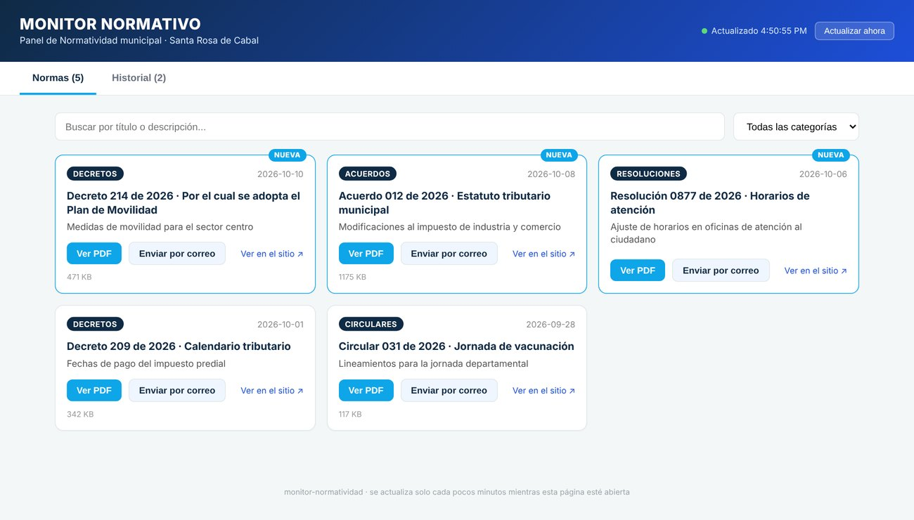
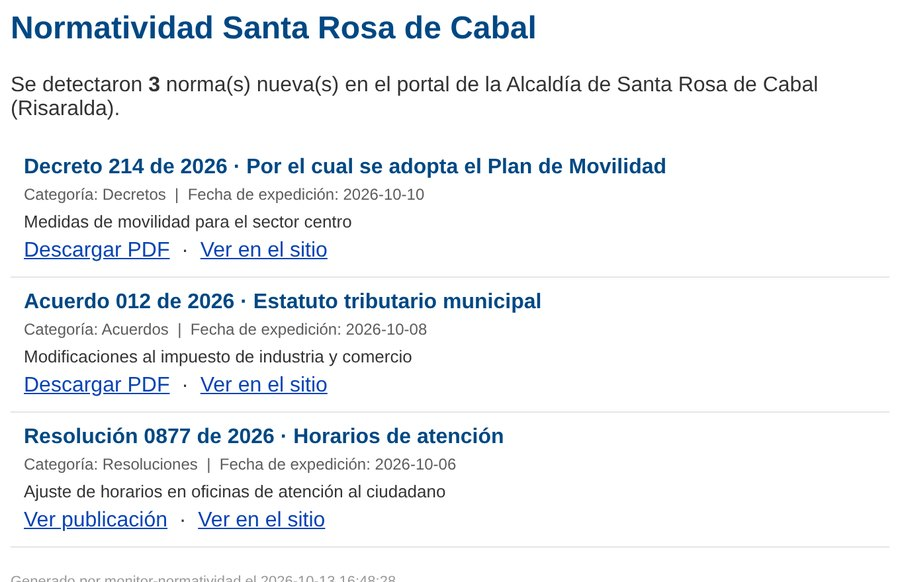
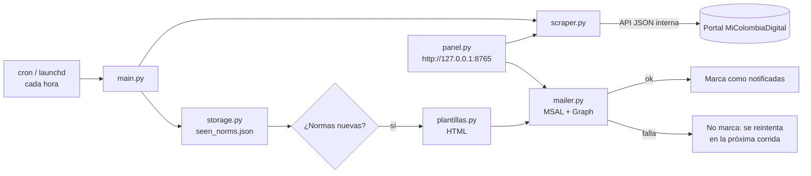

<div align="center">

# 📜 Monitor de normatividad municipal

**Vigila cada hora el portal de normatividad de una alcaldía, avisa por correo cuando sale un decreto, acuerdo o resolución nuevo e incluye un panel web local para consultarlos.**

[](https://github.com/juandbueno9/monitor-normatividad-municipal/actions/workflows/ci.yml)




</div>

---

## 🎯 Problema

El área jurídica tenía que entrar todos los días al portal de la alcaldía para ver si había normas nuevas que afectaran a la organización (impuestos, horarios, movilidad). Era fácil pasar alguna por alto.

## ✅ Solución

- **Monitor programado** (cron/launchd, cada hora) que detecta publicaciones nuevas y envía **un correo HTML** con título, categoría, fecha y enlace al PDF.
- **Panel web local** para buscar, filtrar por categoría, ver el historial de ejecuciones y **reenviar una norma puntual** por correo.

<div align="center">

<br/><sub>Correo de alerta (datos de ejemplo)</sub>
</div>

---

## 🏗️ Arquitectura



### Decisiones técnicas

| Decisión | Por qué |
|---|---|
| **API JSON interna en vez de scraping HTML** | El portal es una SPA en Angular que no trae el listado en el HTML. Consumir la API que usa la propia página es más rápido, estable y no necesita navegador headless |
| **Solo se marca como notificada si el correo salió** | Un fallo temporal de red o de Graph no hace perder alertas |
| **Escritura atómica con respaldo** (`tempfile` + `os.replace` + `.bak`) | Un corte de luz a mitad de la escritura no corrompe el registro |
| **Reintentos con backoff** (`urllib3.Retry`) | Tolera caídas momentáneas del portal |
| **Panel con `http.server` de la librería estándar** | Cero dependencias web extra; escucha solo en `127.0.0.1` |
| **Logs con rotación** (`RotatingFileHandler`) | No llena el disco |

---

## 🚀 Instalación

```bash
git clone https://github.com/juandbueno9/monitor-normatividad-municipal.git
cd monitor-normatividad-municipal
python3 -m venv .venv && source .venv/bin/activate
pip install -r requirements.txt
cp .env.example .env
```

### Variables de entorno

| Variable | Descripción |
|---|---|
| `MS_TENANT_ID` / `MS_CLIENT_ID` / `MS_CLIENT_SECRET` | App de Entra ID con `Mail.Send` de aplicación |
| `MAIL_SENDER` | Buzón remitente |
| `MAIL_RECIPIENTS` | Destinatarios separados por coma |
| `SCRAPE_PAGE_SIZE` | Publicaciones consultadas por ejecución (por defecto 30) |
| `PANEL_REFRESH_SECONDS` | Cada cuánto se actualiza el panel (por defecto 300) |
| `LOG_LEVEL` | `DEBUG`, `INFO`, `WARNING` o `ERROR` |

## 🖥️ Uso

```bash
python main.py          # una pasada (para cron / launchd)
python main.py --loop   # en primer plano, repite cada hora
python panel.py         # panel web en http://127.0.0.1:8765
```

**Programación:**

```cron
# Linux
0 * * * * cd /opt/monitor-normatividad && .venv/bin/python main.py
```

En macOS ajusta las rutas en `com.empresa.normatividad.plist` y cárgalo con `launchctl load`.

**Adaptarlo a otra alcaldía:** muchas alcaldías de Colombia usan la plataforma MiColombiaDigital. Basta con cambiar `PUBLIC_BASE_URL` y `API_BASE_URL` en `scraper.py`.

---

## 📁 Estructura

```text
monitor-normatividad-municipal/
├── main.py          # Orquestador (una pasada o --loop)
├── scraper.py       # Cliente de la API del portal (reintentos, dataclass Norma)
├── storage.py       # Registro de vistos e historial con escritura atómica
├── plantillas.py    # Correo HTML
├── mailer.py        # Microsoft Graph con MSAL (client credentials)
├── panel.py         # Panel web local (stdlib) con búsqueda, filtros y reenvío
├── com.empresa.normatividad.plist
└── docs/            # Capturas
```

---

**Autor:** [Juan Bueno](https://github.com/juandbueno9) · Licencia [MIT](LICENSE)
